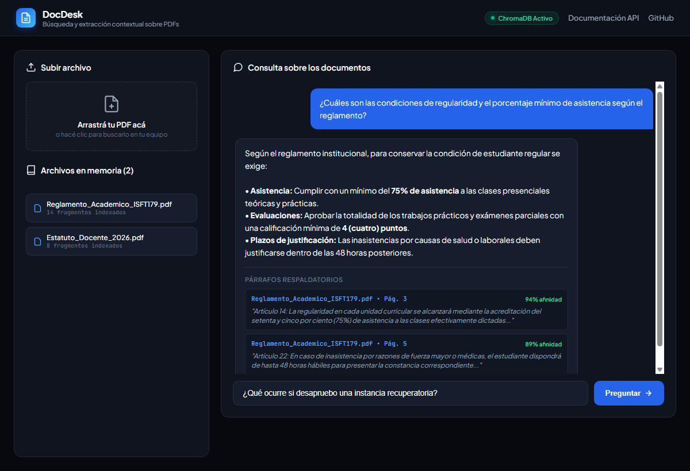

# Asistente Documental RAG (DocDesk) 📄🤖

Sistema de producción para **Análisis y Consulta de Documentación Técnica** mediante **RAG (Retrieval-Augmented Generation)**, desarrollado con **FastAPI**, **ChromaDB**, **PyPDF** y la API de **Google Gemini**.

Permite cargar manuales, reglamentos o contratos en PDF, indexar semánticamente su contenido en fragmentos vectorizados y responder consultas complejas en lenguaje natural con **citas precisas del documento y número de página**.


<br/>

<p align="center">
  
</p>

---

## 🏗️ Arquitectura del Sistema

```
                      +-------------------+
                      |   Documento PDF   |
                      +---------+---------+
                                |
                                v
                      +-------------------+
                      |  PDF Text Parser  |  (pypdf / extracción por página)
                      +---------+---------+
                                |
                                v
                      +-------------------+
                      | Semantic Chunking |  (500 palabras + 60 overlap)
                      +---------+---------+
                                |
                                v
                      +-------------------+
                      | Vector Database   |  (ChromaDB / Embeddings Cosine)
                      +---------+---------+
                                |
       +------------------------+------------------------+
       |                                                 |
       v (Búsqueda semántica)                            v (Persistencia local)
+--------------+                                  +--------------+
| Query Search |  (Top-K fragmentos afines)        |  data/vector |
+-------+------+                                  +--------------+
        |
        v
+-------------------+
| Prompt Synthesis  |  (Inyección estricta de contexto sin alucinación)
+-------+-----------+
        |
        v
+-------------------+
|   Google Gemini   |  (gemini-1.5-flash / LLM Generativo)
+-------+-----------+
        |
        v
+-------------------+
|  Respuesta Final  |  (Síntesis clara + citas de página + score)
+-------------------+
```

---

## ✨ Características Principales

- **Procesamiento de Documentos:**
  - Extracción de texto preservando metadatos exactos de número de página.
  - Troceado semántico inteligente (*sliding window chunking*) con solapamiento (*overlap*) para evitar cortes de contexto.
- **Base de Datos Vectorial Persistente (ChromaDB):**
  - Almacenamiento local persistente con cálculo de similitud coseno (*HNSW / Cosine Space*).
  - Motor de búsqueda híbrido con fallback semántico nativo para máxima resiliencia.
- **Salvaguardas contra Alucinaciones:**
  - Prompt de sistema con directivas estrictas de validación.
  - Respuestas fundamentadas únicamente en el contenido extraído.
- **Frontend Interactivo Integrado:**
  - Panel web moderno para subir PDFs vía Drag & Drop.
  - Historial de chat en tiempo real con tarjetas desplegables de fuentes consultadas.
- **API REST Documentada:**
  - Especificación OpenAPI estándar accesible en `/docs` (Swagger UI).
  - Suite de pruebas unitarias automatizadas con **Pytest**.

---

## 📂 Estructura del Proyecto

```text
rag-doc-assistant/
├── app/
│   ├── api/
│   │   ├── __init__.py
│   │   └── endpoints.py      # Endpoints REST (Upload, Query, List, Delete, Health)
│   ├── core/
│   │   ├── __init__.py
│   │   └── config.py         # Configuración y variables de entorno (.env)
│   ├── services/
│   │   ├── __init__.py
│   │   ├── pdf_loader.py     # Parser de PDF y algoritmo de chunking
│   │   ├── vector_store.py   # Conexión persistente a ChromaDB y motor vectorial
│   │   └── rag_engine.py     # Orquestador RAG y conexión con LLM
│   ├── static/
│   │   └── index.html        # Panel web interactivo para usuario final
│   ├── __init__.py
│   └── main.py               # Aplicación FastAPI y montaje de rutas
├── data/
│   ├── uploads/              # Archivos PDF originales subidos
│   └── vectorstore/          # Índice y base de datos vectorial ChromaDB
├── tests/
│   └── test_rag.py           # Pruebas automatizadas (chunking, vector store, API)
├── .env.example              # Plantilla de variables de entorno
├── .gitignore                # Reglas de exclusión de Git
├── requirements.txt          # Dependencias del proyecto
├── run.py                    # Script de inicio rápido
└── README.md                 # Documentación técnica
```

---

## 🚀 Instalación y Puesta en Marcha

### 1. Clonar el repositorio
```bash
git clone https://github.com/urhiel-tao/rag-doc-assistant.git
cd rag-doc-assistant
```

### 2. Crear y activar el entorno virtual
En Windows PowerShell:
```powershell
python -m venv .venv
.\.venv\Scripts\activate
```

### 3. Instalar dependencias
```bash
pip install -r requirements.txt
```

### 4. Configurar variables de entorno (Opcional para modo IA)
Copia el archivo `.env.example` a `.env`:
```powershell
Copy-Item .env.example .env
```
Edita `.env` y coloca tu clave de API gratuita de [Google AI Studio](https://aistudio.google.com/app/apikey):
```env
GEMINI_API_KEY=tu_api_key_aqui
GEMINI_MODEL=gemini-1.5-flash
```
*(Nota: Si no colocas la API Key de inmediato, el sistema funciona en modo demostración local recuperando los fragmentos y citas exactas).*

### 5. Iniciar la aplicación
```bash
python run.py
```

- **Panel Web Interactivo:** [http://127.0.0.1:8000](http://127.0.0.1:8000)
- **Documentación Swagger UI:** [http://127.0.0.1:8000/docs](http://127.0.0.1:8000/docs)

---

## 🧪 Ejecución de Pruebas Automatizadas

Para validar todos los módulos del sistema (parser, chunking, motor vectorial y endpoints):

```powershell
$env:PYTHONPATH = "."
pytest tests/
```

---

## 📡 Endpoints de la API

| Método | Endpoint | Descripción |
| :--- | :--- | :--- |
| `POST` | `/api/upload` | Sube un archivo PDF, extrae texto, trocea e indexa en ChromaDB. |
| `POST` | `/api/query` | Realiza una pregunta en lenguaje natural y retorna respuesta + citas. |
| `GET` | `/api/documents` | Lista todos los documentos actualmente indexados y cantidad de chunks. |
| `DELETE` | `/api/documents/{doc_name}` | Elimina un documento y purga sus fragmentos de la base vectorial. |
| `GET` | `/api/health` | Estado de salud del servicio y métricas de chunks almacenados. |

---

## 👤 Autor

- **Héctor Uriel Taño Fernández**
- Estudiante de Análisis de Sistemas | Desarrollador Python
- GitHub: [@urhiel-tao](https://github.com/urhiel-tao)
- Email: [urhieltatao@gmail.com](mailto:urhieltatao@gmail.com)
